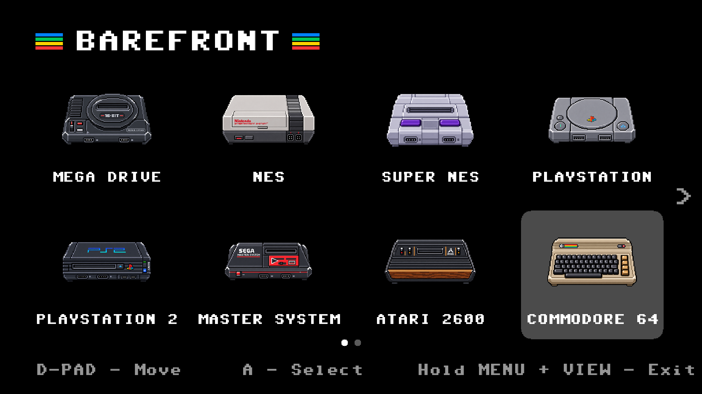
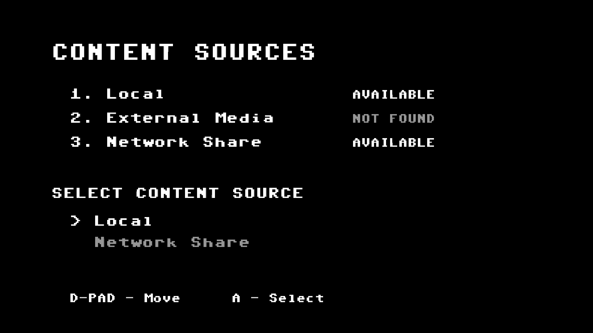
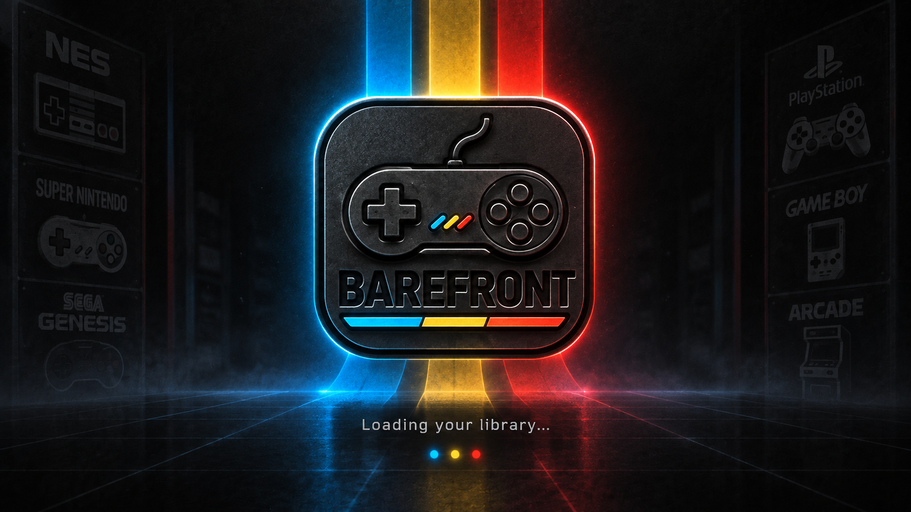
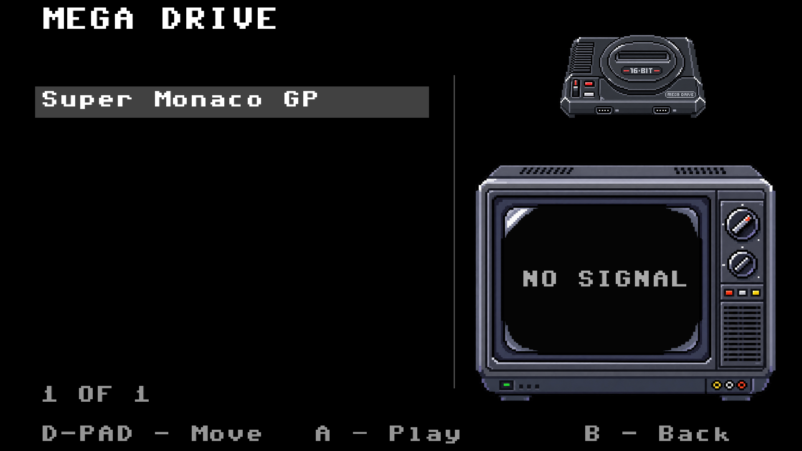
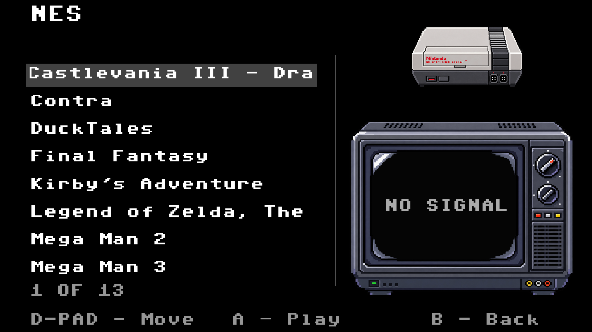

# BareFront for Omarchy

Preview of BareFront's complete first-install experience on
Omarchy. Installation sets up the frontend, all supported emulators, controller
helpers, shaders, capture tools, configuration and desktop launcher. ROMs and
BIOS files are supplied by the user.

## Screenshots

Main system selection:



Resource selection (local, external media or network share):



Startup splash:



Mega Drive game menu:



NES game menu:



Screenshots show a user-provided library. ROMs, BIOS files and game preview
media are not supplied by the installer.

## Install

Run from a normal user account in an Omarchy terminal:

```bash
git clone https://github.com/caderbyshire/BareFront-Omarchy.git
cd BareFront-Omarchy
bash ./install.sh
```

The installer uses Arch packages, builds Amiberry through Omarchy's AUR command,
and retains BareFront's upstream downloads for its locally managed emulators.
Package installation requests sudo access. Optional network-share setup follows
the original installer. Downloads and builds can take some time.

The default application directory is `~/.local/share/barefront`. Set
`BAREFRONT_INSTALL_DIR` to an absolute path to choose another directory. Re-run
the installer to resume a failed installation; existing configuration is retained.
The source is copied on first installation; this preview does not implement
application upgrades.

## Omarchy plugin

This folder is also a shell plugin (`barefront.launcher`). Its bar button opens
the complete installer in a terminal on first use and launches BareFront after
installation. It does not run package installation in the background.

For local development, copy this folder to
`~/.config/omarchy/plugins/barefront.launcher`, then run:

```bash
omarchy plugin validate ~/.config/omarchy/plugins/barefront.launcher
omarchy plugin enable barefront.launcher right
```

Alternatively, install the plugin with:

```bash
omarchy plugin add https://github.com/caderbyshire/BareFront-Omarchy --enable
```

Adding the shell plugin installs
the button; the first click installs the application and emulators.

Removing the shell plugin leaves the application, ROMs, BIOS files and saves in
the application directory. They are never stored in the shell plugin directory.

```bash
omarchy plugin remove barefront.launcher
```

This removes the bar integration only. Keep `~/.local/share/barefront` to retain
the application and user data; emulator packages are shared system packages and
are not removed. No automatic application or save deletion is provided.

## License and dependencies

BareFront and this integration use GPL-3.0-or-later; see `LICENSE`. Bundled fonts,
shaders and other third-party assets retain their accompanying licenses.
External dependencies include Omarchy/Quickshell, Arch emulator packages, the
Amiberry AUR build, upstream emulator downloads, compiler tools, SDL, PipeWire,
GStreamer, Vulkan, and the private Gamescope/vkBasalt presentation runtime.
The full package list and pinned downloads are in `installer/adapt.py`,
`installer/install-runtime.sh` and `application/scripts/install_barefront.sh`.

## Current limits and validation

Targets Omarchy 4, x86-64 and 1920×1080 output. Other resolutions and architectures
are not validated. Existing local testing covered runtime rendering and selected
emulator launches; a clean-machine installation and all-system controller tests
are still required before a stable release.

The plugin manifest and shell syntax have been validated. Isolated bootstrap
checks covered first installation, paths with spaces, installer error propagation,
saved-data preservation, and refusal to overwrite unmanaged directories. These
checks used a simulated package installer; they do not replace a fresh Omarchy
installation or a live shell-widget test. The full installer completed on an
existing Omarchy machine on 14 October 2026, and the installed frontend launched
successfully. The user reported that it worked. That machine already had emulator
packages and a configured NAS; this does not establish clean-machine coverage.

The private presentation runtime uses BareFront's checksum-pinned patched
Gamescope and vkBasalt, with two private Debian compatibility libraries. No
Debian libraries are installed system-wide. Physical PAL refresh switching on
Hyprland is not implemented.

Logs are under `~/.local/share/barefront/logs/install-arch.log` by default.
The original Debian installer remains bundled unchanged; `installer/adapt.py`
generates the Arch version and refuses unexpected upstream changes.
